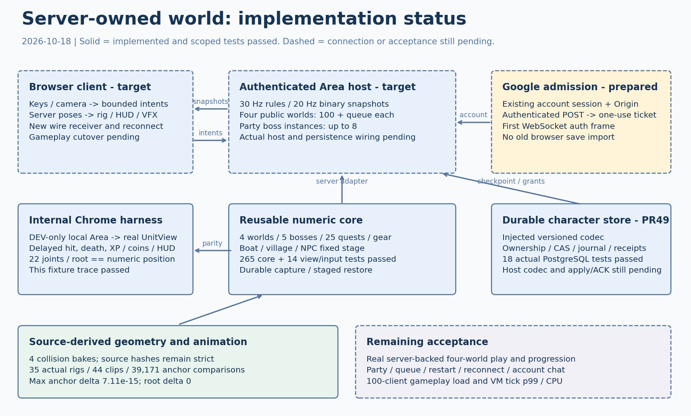

# S2 숫자 코어와 서버 연결 경계

`src/sim/`은 실제 전투와 네 월드를 Node에서 실행한다. `docs/server-world.md` 6장의 결정이 이전 단계 제안보다 우선한다. 최종 gameplay authority는 authenticated server Area이고 browser는 입력과 화면을 담당한다.

현재 `?simCore=1`은 Vite DEV에서만 켜지는 내부 Chrome 검증 경로다. 이 경로에서 local Area를 실행해 실제 rig와 HUD를 검사한다. production build의 기존 gameplay는 그대로 유지한다. 전체 서버 세계 전환, 실제 host와 영속 저장 연결은 아직 완료되지 않았다.

의존 PR [S1 #26](https://github.com/inhyk/crabcraft/pull/26), [S3 #25](https://github.com/inhyk/crabcraft/pull/25), [S4 네트워크 #30](https://github.com/inhyk/crabcraft/pull/30), [QA #36](https://github.com/inhyk/crabcraft/pull/36)은 dev에 머지됐다. 이번 코어에는 equipment와 forge가 포함된 canonical dev `c5e5a6b`도 반영했다. PR #49의 character store는 별도 준비 코드이며 실제 Area와 연결되지 않았다.

## 실행 경계



실선 상자는 구현과 제한된 검사가 있는 부분, 점선은 연결 또는 최종 수용 검사가 남은 부분이다. 이 그림의 검사 수치는 아래 명시한 checkpoint 기준이다.

`SimulationArea`는 입력, 시계, RNG, ID, timer, 전투, 적과 보스, 보상, action과 projectile을 소유한다. 고정 간격은 `1 / 30`초다. 입력 명령 순서를 보존하며 같은 sequence를 다시 실행하지 않는다. `snapshot()`과 `debugState()`는 복사한 불변 값을 반환하고 `drainEvents()`는 순서가 붙은 관측을 소비한다. event sink는 피해나 보상을 다시 적용하지 않는다.

`AreaId / EntityId / life` 전체가 개체 수명 참조다. respawn 후 이전 참조는 무효다. 전역 RNG, 실제 시계, DOM, THREE와 기존 browser game 모듈을 core에서 금지한다. import guard와 Node 직접 import 검사가 이를 확인한다.

| 모듈 | 구현 범위 |
| --- | --- |
| `player`, `combat`, `abilities` | 세 클래스의 13종 기술과 15개 slot, GCD와 자원, 시전과 채널, 이동과 재생성, 장비 공격과 방어 배율 |
| `enemy`, `boss` | 일반 적 AI, Rust/Abyss/Eclipse/Dawn/Frost 다섯 profile, mechanic, add pool, reset과 freed 상태 |
| `areas`, `outcomes`, `interactions` | 네 월드 배치, 25개 퀘스트, 개인 prop, 보스 재도전과 기여자별 전체 보상, 장비 구매와 강화 |
| `features` | 순수 boat와 village 규칙, named NPC와 주민 controller. Area fixed stage에서 한 번씩 실행 |
| `transfer` | 입장 예약과 staging, 소유권 CAS, 시계 변환, 보상 mailbox와 재시도 |
| `actions`, `projectiles`, `pose` | 실제 clip 명중 시각, fade와 취소 시 root carry, canonical clawR에서 시작하는 비행 |
| `game/simUnitView`, `game/playerInput` | native Vector3 live facade, rig에 numeric pose 적용, held 입력과 once-only edge 축적 |

새 코어의 public 정원은 100명, party-encounter는 8명이며 actor와 유효한 입장 예약을 함께 센다. 실제 public 대기열, party admission과 Google 계정의 중복 접속 관리는 host 단계에서 연결한다. 현재 legacy 코드 방 정원 8명과 elected host protocol은 바꾸지 않는다.

월드 정의는 순수 `WorldQuery`와 명시적인 level 및 population 설정을 받는다. 테스트와 내부 Chrome의 값은 fixture이며 운영 밸런스 승인값이 아니다. `enemyPopulation.desired`는 명시한 spawn 하나에 대한 `0 | 1`이다. 근처 인원에 따른 추가 spawn과 빠른 respawn은 아직 구현하지 않았고 정확한 운영 설정도 미정이다. 기존 22m 재생성 안전 조건은 유지한다.

네 월드의 baked query를 Node에서 직접 읽는다. Dawn의 개인 prop 배치는 actor bounds wrapper를 통과하지 않는 raw collision provider로 계산한다. 실제 21개 원본 위치와 비교한다. named NPC와 freed 27종에 실제 주민 8종을 더한 35종 rig가 catalog에 있다. 주민 외형과 W1 위치는 실제 seed 1337 생성 순서를 따르고 W2 route, W3 z+3, W4 z+2 배치를 각각 유지한다.

## 이동과 보상 소유권

host는 Area의 `characters` 옵션과 `InMemoryTransferCoordinator`에 같은 `CharacterRegistry`를 주입해야 한다. registry는 fresh attach, respawn life 변경과 이동 CAS에 함께 참여한다. 현재 coordinator와 award mailbox는 메모리 구현이다.

실패한 이동은 actor, RNG, action, timer, event, context와 소유권을 복구한다. 이미 발급한 transaction nonce와 비공개 staging ID는 소비한 채로 유지한다. 취소한 token을 새 이동에 재사용하지 않는다. source grant ACK는 이동 commit 뒤에 처리하고 보상 전달은 별도로 재시도한다.

다섯 보스는 재도전마다 fresh life를 받는다. 실제 피해 기여자 모두 매 승리 전체 XP와 coins를 받으며 개인 이야기 진행은 한 번만 완료한다. 이미 현재 owner에게 반영한 grant의 `appliedHere` 상태를 host journal이 보존해야 한다. 단순히 모든 grant를 다시 apply하면 안 된다.

tick 도중 한도를 넘은 Area는 다음 tick을 거부한다. host가 내구성 있는 저장과 grant 기록을 완료하고 Area를 폐기해야 하며 실패한 Area를 계속 실행하지 않는다. `TransferDTO`는 정상 travel용이다. 죽음, 배 탑승, village 중 logout과 restart용 checkpoint 경계를 대신하지 않는다.

개인 checkpoint는 실제 appearance 전체, 25개 퀘스트, 장비, 15개 업적과 별도 secret 상태, 생존 상태, cooldown/status/history duration과 중단된 동작을 포획한다. 순수 `RestorePolicy`가 명시적으로 필요한 복원 규칙을 결정한다. 죽음, 배와 village 상태에서도 읽기 전용 포획이 가능하다. `stageRestoredArrival`은 비활성 actor를 준비하고 소유권 CAS 뒤 활성화한다. quiesce/capture, 저장된 정확한 receipt의 mark, durable retirement와 실패 복구 경계가 있다. 아직 실제 host DB 연결 검증을 뜻하지 않는다.

미저장 receipt는 캐릭터당 256개까지다. 전체 기여자 집합이 한도를 넘으면 첫 진행 변경 전에 거부한다. 일반 travel에서도 이미 저장한 receipt와 미저장 receipt의 구분을 보존한다. 256개를 저장하고 W1에서 W2로 이동한 후 예전 보상은 중복 처리하고 새 257번째 보상 하나만 미저장으로 남는 회귀를 포함한다.

## 실제 모션 데이터와 검사

`tools/bake-sim-motion.mjs`는 실제 Chrome `MotionLibrary`, GLB와 rig factory를 읽는다. packed artifact에는 float32 sample, root curve, socket chain, collider, scale과 원본 SHA256이 있다. 누락 clip과 archetype은 오류이며 대체 pose를 만들지 않는다. pose cache는 unit마다 소유한다.

이전 검증 checkpoint의 provider는 `shipped-motion-v1-8240fb40fe64b2d6968a`다. [현재 35종 raw 비교 결과](evidence/s2-rig-catalog-parity-unit5644568.json)를 보존한다. 실제 추출 checkpoint는 `18df9de`이며 Game은 `9dbbb45`, Unit은 readonly observation을 추가한 `5644568`이다. 공유 rig catalog `shipped-rigs-v1-ebaae7f29b7855b604c6`는 18,522 bytes이며 motion version에 묶인다. clip 전체를 포함하지 않는다.

| 비교 | 표본 | 최대 차이 |
| --- | ---: | ---: |
| Clip sampling | 1,232 | 0 |
| ClawR 위치, 35종 rig와 36종 race/sex/class 조합 | 39,171 | 7.105427357601002e-15 world unit |
| 자연 종료, 취소와 중복 stop의 root carry | 238 | 0 |

112개 source hash와 packed content hash를 검사한다. Game, Unit, motion 또는 rig 원본이 바뀌면 실제 bake와 독립 production rig/controller 비교를 다시 한다. hash 제외, 수동 정답 치환, 허용 오차 완화로 검사를 통과시키지 않는다.

undead 계열 view의 무작위 servo twitch는 canonical authority pose에서 제외한다. 비교한 각 계열 708개 pose의 target 구성에서 최대 도착 차이는 0.030312초, 30Hz 기준 최대 1tick이었다. 모든 연속 pose에 대한 상한이 아니다. 기존 view twitch는 유지한다. 이전 14종 결과도 [원래 근거](evidence/s2-motion-parity.json)로 남긴다.

## 실행한 검사

Node 24.22.0과 pnpm 10.10.0을 사용했다. aggregate `293b124`에서 core 265/265, view/input 14/14와 build가 통과했다. 이 checkpoint는 boat/village/NPC Area 연결, strict full-appearance checkpoint codec, durable lifecycle과 readonly server Unit binding을 포함한다.

```sh
pnpm test:sim:core
node --test tests/sim-view-input.test.mjs
pnpm build
node tools/qa-sim-motion-data.mjs --output /tmp/s2-motion-parity.json
node tools/qa-numeric-core.mjs --url http://127.0.0.1:5259
```

parent의 별도 Vite/Chrome trace에서 실제 Digit1 입력부터 numeric 지연 명중, 사망, XP +20과 coins +5, HUD와 rig root 반영까지 확인했다. 지연은 0.2667초, 22개 관절, root와 numeric 좌표 동일, pageerror 0이었다. 적 HP 1, stun, rage 100과 god mode는 명시적 fixture다. 이 trace는 네 월드의 완전한 렌더 검증이나 서버 접속 증거가 아니다.

기존 boss, engine, multiplayer와 account server 검사는 core 테스트와 별도로 최종 PR head에서 실행해야 한다. motion QA는 로컬 Chrome과 비어 있는 전용 port를 쓰며 종료 시 browser와 자체 Vite를 닫는다. `test:sim:core`는 `tests/core-*.test.mjs`를 발견해 실행하고 파일이 없으면 실패한다.

## 남은 연결과 수용 검사

- 실제 authenticated host, 새 gameplay wire의 life/catalog/명령/개인 진행, browser receiver와 reconnect를 연결한다. 기존 S4 fixture의 synthetic 이동은 실제 Area 실행을 대신하지 않는다.
- Google 로그인 계정에 새 level-1 캐릭터를 만든다. browser save를 가져오지 않는다. 구현된 pure 저장 codec과 durable attach/detach를 실제 host, journal/receipt와 SIGTERM 저장에 연결한다.
- 실제 서버에서 네 월드 이동, 다섯 보스와 party 8명, 25개 퀘스트와 개인 prop, 장비, boat와 village, 계정 채팅 보호를 검증한다. public 월드별 한 Area와 100명 초과 대기열을 검증한다.
- 실제 gameplay 100 clients와 browser 2개, 끊김과 restart 복구, VM tick p99와 CPU를 측정한다. p99 10ms 또는 CPU 60% 기준을 적용한다.

production 서버 실패 시 offline Area나 legacy authority로 자동 전환하지 않는다. 현재 production legacy 경로는 새 경로 전환 전까지 회귀 호환을 유지한다. 구현 세션은 PR을 만들고, 지정된 별도 리뷰 세션이 merge와 dev 배포를 수행한다.

## PR52 반영 후 foundation 재검증

최신 dev `b051b47`의 Dawn HP24000/damage20/tempo0.95, Frost HP90000/damage38/tempo0.9와 endgame mechanic 피해/경고/간격을 numeric에 반영했다. 월드별 고정 적 레벨, W2/W3 scavenger guardian의6초 respawn과8m clearance, echo120초를 보존한다. 후속 host의 dynamic population/recovery API는 이 갱신에 포함하지 않았다.

motion과 catalog는 실제 추출 도구로 다시 생성했다. provider는 `shipped-motion-v1-ba88643928a0d7d99cf1`, catalog는 `shipped-rigs-v1-4dbbf3d590588988ab79`다. [새 raw 비교 결과](evidence/s2-pr52-motion-parity.json)는 source112,35rig,39171anchors,238roots,12038catalog anchors를 기록하며 maxAnchorDelta7.105427357601002e-15, root/catalog delta0이다. 이전 checkpoint 증거도 보존한다.

리뷰 worktree에서 Node24.22/pnpm10.10으로 core269/269, view/input14/14, boss116/116, engine4/4, sim47/47, multiplayer50/50, world61/61, server17/17과 build를 통과했다. 새 base의 DEV W1 Chrome fixture trace도 지연 명중, 죽음, XP20/coins5,22관절/root 동기화와 pageerror0을 확인했다. 실제 host/v3/client/production 전환과 네 월드 전체 렌더 수용은 여전히 후속 범위다.
